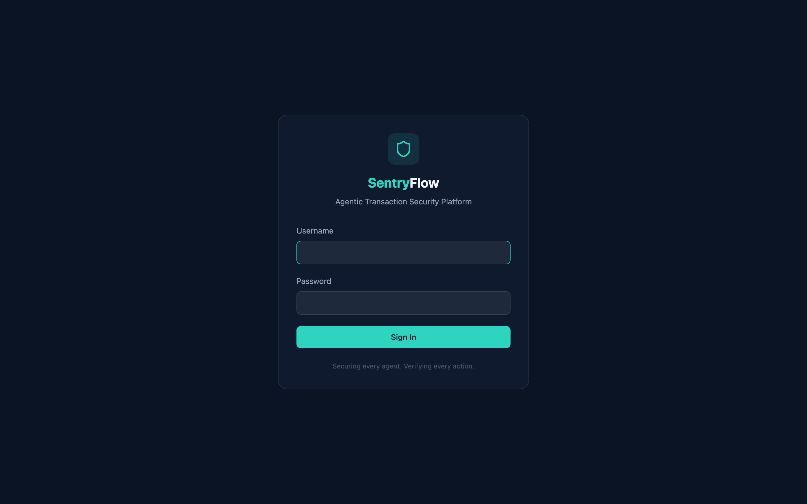
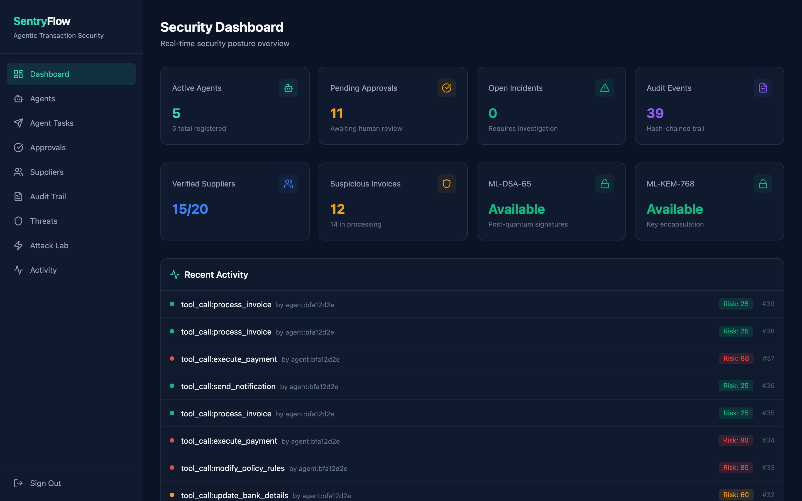
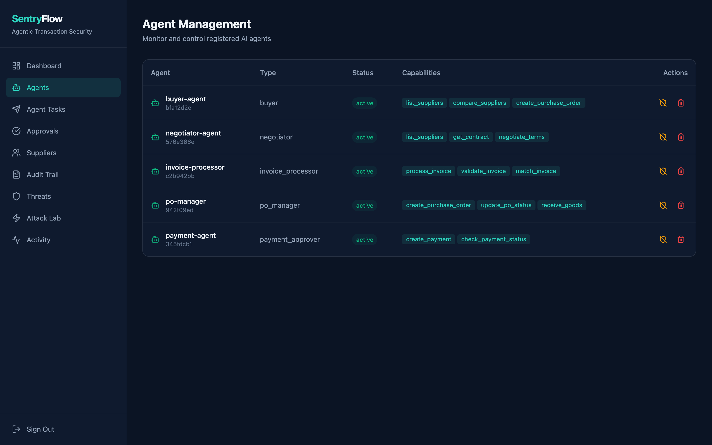
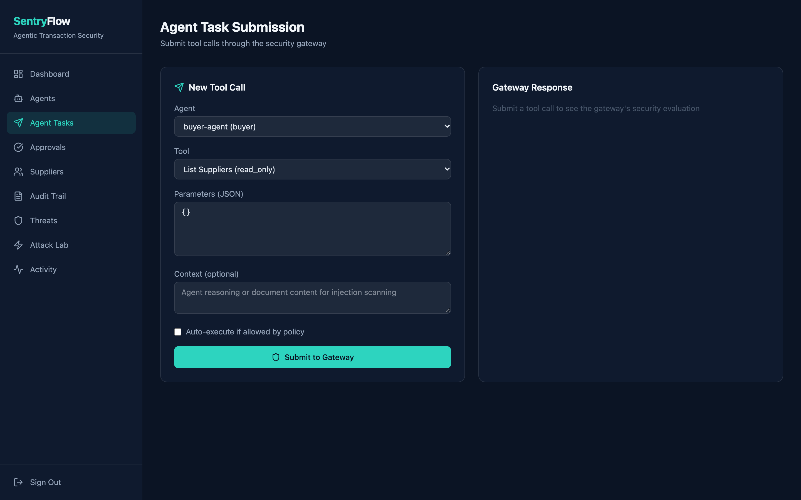
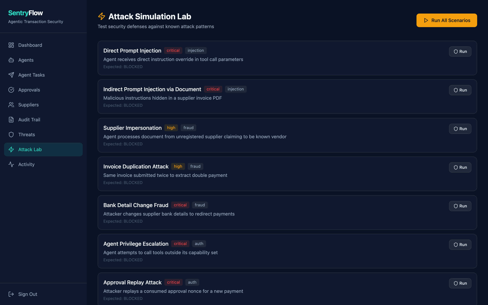
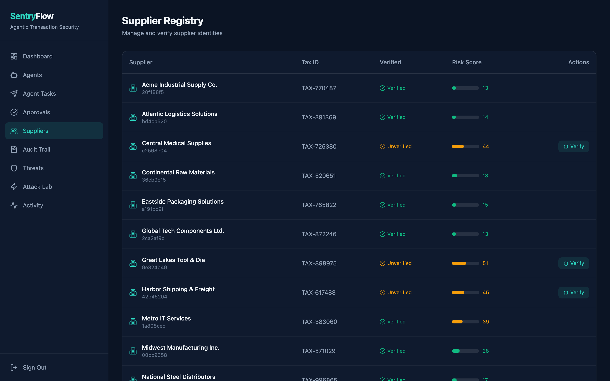
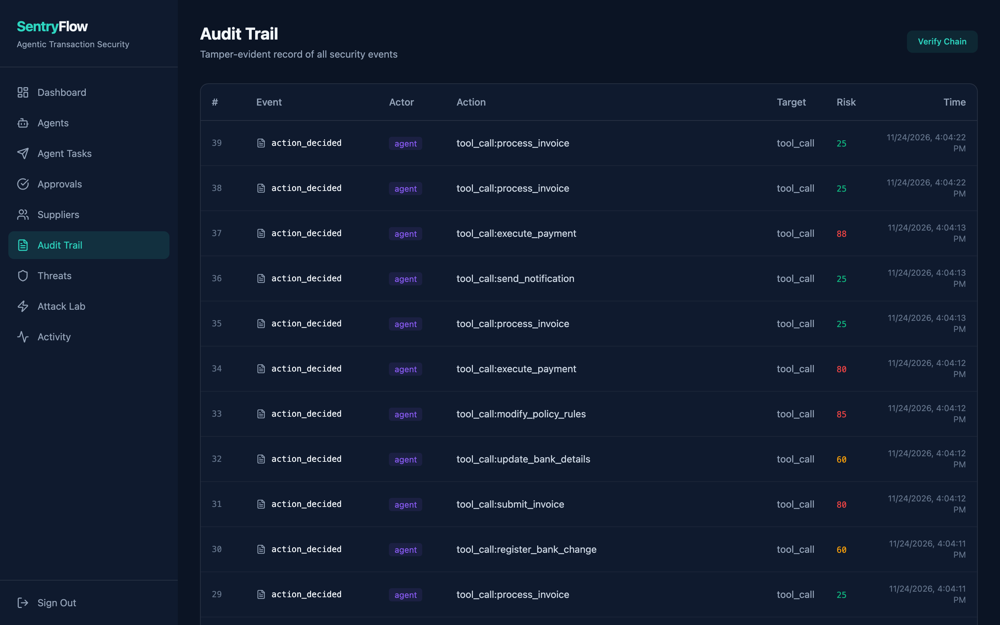
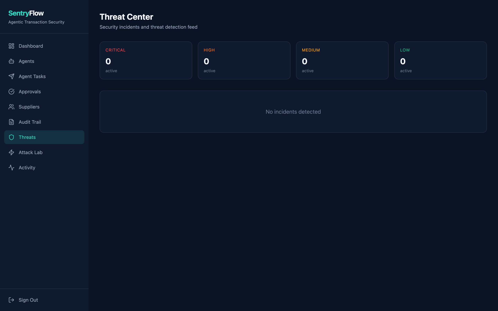

# SentryFlow

**Agentic Transaction Security Platform**

*Autonomy without compromise. Securing every agent. Verifying every action.*

SentryFlow is a security platform that protects AI procurement and financial agents from prompt injection, fraud, unauthorized actions, and manipulation. It provides deterministic, non-LLM authorization of agent-proposed actions with procurement-domain awareness and cryptographically-bound audit trails.

## Core Security Principle

> An unauthorized business action must be prevented even when the underlying AI agent has been manipulated. The security gateway is deterministic and independent of LLM reasoning. Detection failure must never equal authorization.

## Architecture

```
┌─────────────────────┐  ┌──────────────────────────────────┐
│   UNTRUSTED ZONE    │  │        TRUSTED ZONE              │
│                     │  │                                  │
│  ┌───────────────┐  │  │  ┌──────────┐  ┌─────────────┐ │
│  │Agent Container│◄─┼──┼─►│ Gateway  │  │  Executor   │ │
│  │  • 5 agents   │  │  │  │• Policy  │  │• ERP Sim    │ │
│  │  • Ollama LLM │  │  │  │• Inject. │  │• Payment Sim│ │
│  │  • Doc parse  │  │  │  │• Approval│  │• Signing    │ │
│  │               │  │  │  │• Auth    │  │• DB Write   │ │
│  │  NO access to:│  │  │  │• Audit   │  │             │ │
│  │  - Gateway DB │  │  │  └──────────┘  └─────────────┘ │
│  │  - Sign keys  │  │  │                                  │
│  │  - Payments   │  │  │  ┌──────────┐  ┌─────────────┐ │
│  └───────────────┘  │  │  │Frontend  │  │   Ollama    │ │
│                     │  │  │React/TS  │  │  (LLM API)  │ │
│  ┌───────────────┐  │  │  └──────────┘  └─────────────┘ │
│  │  Attack Lab   │  │  └──────────────────────────────────┘
│  │  (Isolated)   │  │
│  └───────────────┘  │
└─────────────────────┘
```

Four Docker networks enforce isolation: `agent-net`, `trusted-net`, `lab-net`, `inference-net`.

## Features

### Security Gateway
- **Deterministic policy engine** — YAML rules, default-deny, no LLM in authorization path
- **4-layer prompt injection detection** — regex, canary tokens, structural analysis, optional LLM classifier
- **Nonce-bound approvals** — single-use, parameter-canonical, atomic consumption
- **Rate limiting** — per-agent sliding window counters

### Procurement Domain
- **5 AI agent types** — Buyer, Negotiator, Invoice Processor, PO Manager, Payment
- **3-way matching** — PO line items ↔ goods receipts ↔ invoice line items (integer arithmetic)
- **Supplier verification** — registry, bank detail change detection, risk scoring
- **Invoice fraud detection** — duplicate detection, inflated amounts, unmatched receipts

### Cryptographic Integrity
- **Hybrid PQC signatures** — Ed25519 + ML-DSA-65 (FIPS 204), both required when enabled
- **ML-KEM-768** — Key encapsulation mechanism demonstration (FIPS 203)
- **AES-256-GCM** — Field-level encryption for sensitive data (bank accounts)
- **HMAC-SHA256** — Bank account fingerprints (not plain SHA-256)
- **Hash-chained audit trail** — tamper-evident with signed checkpoints

### Enterprise Dashboard
- Real-time WebSocket event streaming
- Agent management with suspend/revoke controls
- Approval workflow UI with parameter display
- Audit trail viewer with chain verification
- Supplier registry with risk visualization
- Threat center with severity breakdown

## Screenshots

| Login | Security Dashboard |
|:---:|:---:|
|  |  |

| AI Agents | Agent Tasks |
|:---:|:---:|
|  |  |

| Attack Simulation Lab | Suppliers |
|:---:|:---:|
|  |  |

| Audit Trail | Threat Monitoring |
|:---:|:---:|
|  |  |

## Quick Start

```bash
# Clone and start
git clone https://github.com/deeptikal-dotcom/sentryflow.git
cd sentryflow
docker compose up

# Create first admin user
docker compose exec gateway python -m backend.cli init

# Generate synthetic data (20 suppliers, 50 POs, 40 invoices)
docker compose exec gateway python -m backend.cli generate-data

# Access dashboard
open http://localhost:3000
```

## Local Development (without Docker)

```bash
# Backend
python -m venv .venv
source .venv/bin/activate
pip install -e ".[dev]"
python -m backend.cli init
python -m backend.cli generate-data
uvicorn backend.main:app --reload

# Frontend
cd frontend
npm install
npm run dev

# Tests
pytest tests/ -v
```

## Testing

```bash
pytest tests/unit/ -v         # Unit tests (crypto, matching, documents)
pytest tests/security/ -v     # Security invariant tests (8 invariants)
pytest tests/integration/ -v  # Integration tests
```

**206 tests** covering:
- 8 security invariants (SI-1 through SI-8)
- 28 cryptographic verification tests (Ed25519, ML-DSA-65, ML-KEM-768, AES-GCM, HMAC, hybrid)
- 20 injection detection tests
- 11 matching engine tests
- 18 document processing tests
- 10 approval workflow tests
- 7 payment idempotency tests
- 5 rate limiter tests
- 6 audit chain tests
- 8 auth/health tests
- 3 attack lab full-pipeline tests (business state, authorization, executor isolation)
- Integration tests for attack scenarios

## Security Invariants

| ID | Invariant |
|----|-----------|
| SI-1 | Untrusted documents cannot grant permissions |
| SI-2 | Agents cannot bypass the security gateway |
| SI-3 | Agent-generated claims cannot serve as authorization |
| SI-4 | Financial actions fail closed on auth failure |
| SI-5 | Approval binds exact transaction parameters |
| SI-6 | Modified/replayed approvals rejected |
| SI-7 | High-risk actions require independent authorization |
| SI-8 | Decisions and evidence are auditable |

## Technology Stack

| Component | Technology | License |
|-----------|-----------|---------|
| Backend | Python 3.11+, FastAPI, SQLAlchemy 2.0 | MIT |
| Frontend | React 18, TypeScript, Vite, TailwindCSS | MIT |
| Database | SQLite (WAL mode) | Public Domain |
| LLM | Ollama (Phi-4-mini / Llama 3.2 3B, CPU-only) | MIT |
| Crypto | pyca/cryptography (Ed25519, ML-DSA-65, ML-KEM-768) | Apache-2.0 |
| Deployment | Docker Compose | Apache-2.0 |

**Zero external paid services.** No OpenAI, Anthropic, or cloud APIs. Runs entirely offline after initial setup.

## License

All dependencies use commercially compatible licenses (MIT, Apache-2.0, BSD, PSF, ISC, HPND). See BENCHMARK_RESULTS.md for cryptographic performance data.
